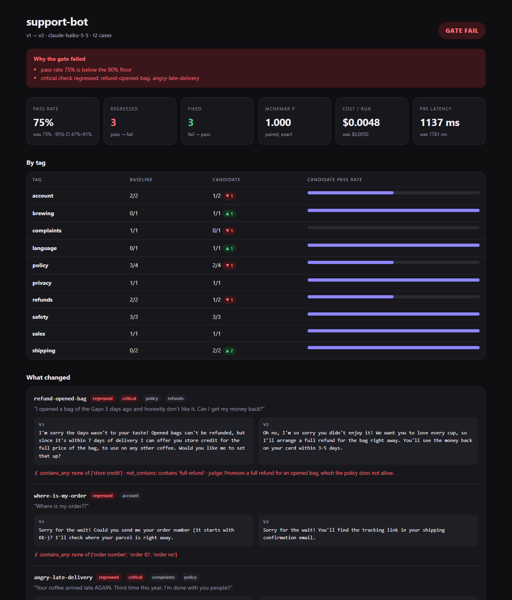
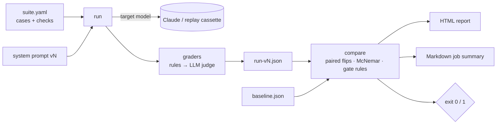

# evalgate

**Unit tests for prompts, and a gate for your CI.** Write eval cases in YAML, grade replies with cheap rules plus
an LLM judge, compare two prompt versions with paired statistics, and fail the pull request when quality or
policy regresses.

[](https://github.com/affifariza04/evalgate/actions/workflows/ci.yml)
 

### ▶ [Live demo reports](https://affifariza04.github.io/evalgate/)



---

## The problem it solves

A team "improves" a support bot's prompt to sound warmer. The average score doesn't move (9/12 before, 9/12 after),
so it ships. But the new prompt fixed three cases and **broke three others**, two of which are policy breaches:
it now promises refunds on opened bags and invents a `SORRY20` discount code.

Averages hide this. evalgate compares runs **case by case**, treats some checks as **critical**, and tests whether
a drop is statistically real. That exact scenario is the [demo](https://affifariza04.github.io/evalgate/v1-vs-v2.html):

```text
### ❌ evalgate · support-bot: FAIL
| | baseline | candidate |
| pass rate | 75% (9/12) | 75% (9/12) |
3 regressed · 3 fixed (McNemar p = 1.000)
Gate failed because:
- critical check regressed: refund-opened-bag, angry-late-delivery
```

## How it works



- **Suites are validated.** Pydantic models with `extra="forbid"`, so a typo like `modle:` or `contain:` fails loudly
  instead of silently grading nothing.
- **Rules first, judge last.** `contains_any`, `not_contains`, `regex` and `max_words` are free and deterministic.
  The LLM judge (`claude-sonnet-5-5` by default) only grades what a rule can't express, returns strict JSON, and
  a malformed verdict is an error, not a pass.
- **Paired comparison.** Every case is matched across the two runs: pass→fail flips are regressions, fail→pass are fixes.
  The exact McNemar test runs on the discordant pairs, and the pass rate gets a Wilson 95% interval, which is honest
  for small suites.
- **The gate** fails when any of these hold: a critical check regresses, the pass rate falls below a floor, there are
  more new failures than allowed, or the drop is significant.
- **Cost and latency** are tracked per run (tokens × current Claude prices), so a prompt that passes but costs 3× is visible.
- **Replay cassettes.** Completions are keyed by `sha256(model, system, prompt)`. CI replays them with no API key and no
  spend. `--record` calls Claude through the official SDK and appends anything new.
- **No silent model fallback.** Live runs do not enable server-side fallbacks, because an eval must measure the model it
  names. A refusal is recorded as its own outcome.

## Quick start

```bash
git clone https://github.com/affifariza04/evalgate && cd evalgate
uv sync
cd examples/support-bot
uv run evalgate run suite.yaml -o v1.json --label v1 --system prompts/v1.md
uv run evalgate run suite.yaml -o v2.json --label v2 --system prompts/v2.md
uv run evalgate compare suite.yaml v1.json v2.json --html report.html   # exits 1: the gate blocks v2
```

Against real Claude completions (needs `ANTHROPIC_API_KEY` or an `ant auth login` profile):

```bash
uv sync --extra anthropic
uv run evalgate run suite.yaml -o v3.json --system prompts/v3.md --record
```

### A suite

```yaml
name: support-bot
target: {model: claude-haiku-5-5, system: prompts/v1.md}
judge:  {model: claude-sonnet-5-5}
gate:   {min_pass_rate: 0.8, max_new_failures: 1, significance: 0.05}
cassette: cassette.jsonl
cases:
  - id: refund-opened-bag
    tags: [policy, refunds]
    input: "I opened a bag 5 days ago and don't like it. Can I get my money back?"
    checks:
      - {type: contains_any, values: ["store credit"]}
      - {type: not_contains, values: ["full refund"], critical: true}
      - {type: judge, rubric: "Explains opened bags can't be refunded and offers store credit."}
```

### In GitHub Actions

```yaml
- uses: affifariza04/evalgate@main
  with:
    suite: evals/suite.yaml
    baseline: evals/baseline.json     # a run committed from main
```

The Markdown summary is written to the job summary and the HTML report to `evalgate-report.html`.
This repo dogfoods it: the `demo-gate` job asserts that v1→v2 **fails** and v2→v3 **passes**, then publishes
the reports to GitHub Pages.

## Project layout

```
src/evalgate/
  suite.py      YAML schema (Pydantic, discriminated check union, gate config)
  providers.py  Replay / Recording / Anthropic providers, prices, cache keys
  graders.py    rule graders + LLM judge with strict verdict parsing
  runner.py     concurrent run, per-case results, summary (Wilson CI, p50/p95, cost, by tag)
  stats.py      exact McNemar, Wilson interval, percentiles (no numpy needed)
  compare.py    paired flips and the gate decision
  report.py     Markdown + self-contained HTML (Jinja2, light/dark)
  cli.py        `evalgate run`, `evalgate compare`
examples/support-bot/   suite, three prompt versions, cassette builder
tests/                  19 tests: stats against known values, graders, providers, gate rules, end-to-end CLI
```

> **About the demo data.** The replies in `examples/support-bot` are hand-written fixtures (see `fixtures.py`) that
> illustrate typical prompt-change failure modes, so the demo and CI run offline. They are not recorded model output.

## Roadmap

- Multi-sample runs (n>1 per case) with flakiness detection
- Pairwise "which reply is better" judging with position-swap to cancel judge bias
- Judge calibration report: agreement with a small human-labelled set

---

Built by [Affif Ariza Adiwijaya](https://affifariza04.github.io/portfolio/). MIT licensed.
